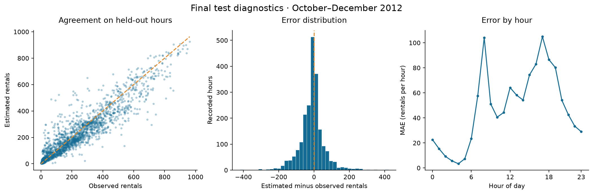

# Modeling Hourly Bike Rental Demand

**Student:** Velimir Ivanov · **GitHub profile:** [Velimir6](https://github.com/Velimir6)

A mathematics and Python course project using the UCI Bike Sharing dataset. The English notebook combines mathematical derivations, a NumPy gradient-descent implementation, chronological model selection and a held-out evaluation.

## Research question

How accurately can hourly rental counts be estimated from calendar and weather conditions, and when do nonlinear models improve on interpretable linear models?

The target is the total number of completed rentals per hour across the system. This is observed rental activity, not a direct measurement of unmet demand or station-level bicycle availability.

Weather observations for the same hour are treated as known inputs. Results under this assumption must not be presented as a deployable advance weather-based forecast.

## Results

| Model | Test MAE | Test RMSE | Test R-squared |
| --- | ---: | ---: | ---: |
| Historical hour/workday mean | 79.95 | 119.59 | 0.648 |
| Selected Random Forest | 48.04 | 73.85 | 0.866 |

The selected model reduces MAE by 39.9% against the baseline on October–December 2012. It uses 120 trees and minimum leaf size 1, selected from 21 candidates across three earlier chronological folds. It does not win every validation period. Rush-hour test MAE is 91.19, so the overall score does not establish peak-hour reliability.



## Files

- `bike_demand.ipynb`: main English report, code and executed outputs.
- `bike_demand.html`: readable exported report; mathematical rendering may use a network-hosted MathJax library.
- `src/`: data audit, feature engineering, models, evaluation and figures.
- `tests/test_core.py`: seven independent numerical and leakage checks.
- `data/raw/`: original UCI data, README and checksum manifest.
- `results/`: validation scores, frozen model settings, test predictions and audit results.
- `EXPERIMENT_PROTOCOL.md`: prespecified selection and testing decisions.
- `SELF_ASSESSMENT.md`: evidence against each grading criterion.
- `GUIDE_BG.md`: Bulgarian explanation and preparation questions.
- `ASSISTANCE.md`: actual contribution and attribution statement.

## Work in VS Code

1. Open this folder in VS Code.
2. Use Python 3.12 and the Microsoft Python and Jupyter extensions.
3. Create a project virtual environment with `py -3.12 -m venv .venv` on Windows, or `python3.12 -m venv .venv` on other systems.
4. In PowerShell, install dependencies using `.\.venv\Scripts\python.exe -m pip install -r requirements.txt`. On macOS/Linux, use `.venv/bin/python -m pip install -r requirements.txt`.
5. Open `bike_demand.ipynb` and select the `.venv` Python kernel.

Choose **Restart Kernel and Run All**. The notebook recomputes the fixed experiment and replaces its result tables. The raw data are included, so only dependency installation needs a network connection. Expect roughly one to several minutes depending on hardware. Exact package versions used for verification are in `requirements.txt`; a full environment snapshot is in `requirements-lock.txt`.

For terminal execution on Windows:

```powershell
.\.venv\Scripts\python.exe -m unittest discover -s tests -v
.\.venv\Scripts\python.exe scripts/execute_notebook.py
```

The second command launches a fresh kernel, executes every code cell, saves the notebook and exports HTML. It stores temporary runtime files under ignored `.runtime/`. Its execution report is `results/execution_check.json`. On macOS/Linux, substitute `.venv/bin/python`.

To run only numerical experiments, use `python scripts/run_analysis.py --stage all`. To regenerate the report source after editing its builder, use `python scripts/build_notebook.py` followed by `python scripts/execute_notebook.py`. Building alone clears executed outputs. Routine readers should open the existing notebook instead.

## Methods

- Historical mean baseline grouped by hour and working-day status, with a training-set fallback for unseen groups.
- Linear regression implemented with NumPy gradient descent and checked against a library solution.
- Ridge regression to investigate regularization.
- Random Forest as a nonlinear comparison.

The development folds validate January–March, April–June and July–September 2012, each using only prior observations for training. October–December 2012 is reserved for final evaluation. All learned preprocessing is training-only. The selected model is evaluated against the fixed historical baseline without using test results to retune it. Re-execution reproduces that same experiment.

## Data and sources

- Fanaee-T, H. (2013). Bike Sharing [Dataset]. UCI Machine Learning Repository. https://doi.org/10.24432/C5W894
- Dataset page: https://archive.ics.uci.edu/dataset/275/bike+sharing+dataset
- Dataset license: CC BY 4.0. Preserve attribution when redistributing data.
- Dataset authors' requested paper citation: Fanaee-T, H., and Gama, J., *Event labeling combining ensemble detectors and background knowledge*, https://doi.org/10.1007/s13748-013-0040-3.
- Related methodological reference: https://scikit-learn.org/stable/auto_examples/applications/plot_cyclical_feature_engineering.html

Additional mathematical and software references appear in the notebook. The dataset's license is separate from the project code. See `ASSISTANCE.md` for Codex's contribution; no claim of unaided student authorship is made.

## Completion checklist

See `PROJECT_CHECKLIST.md` for completed technical checks. The project is published at https://github.com/Velimir6/bike-sharing-project with more than ten substantive development commits preserved. Submitting the repository link through the course platform is a separate action and has not yet been confirmed.
